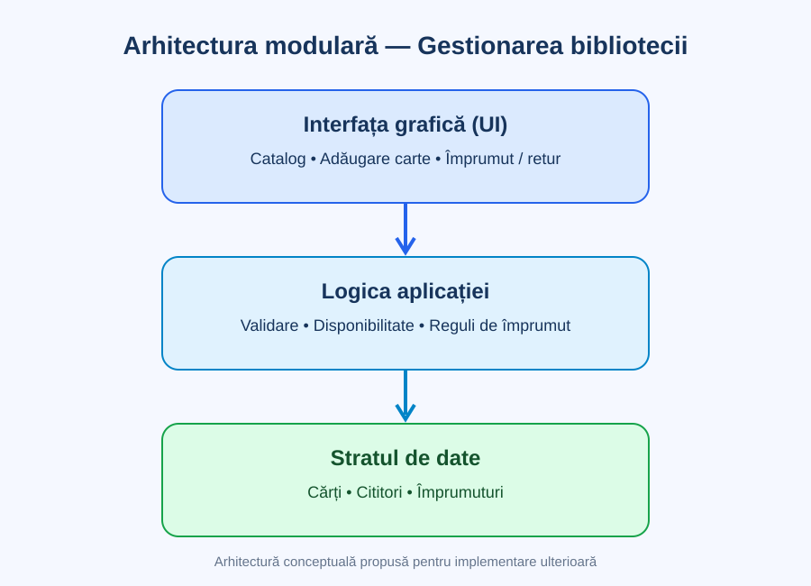
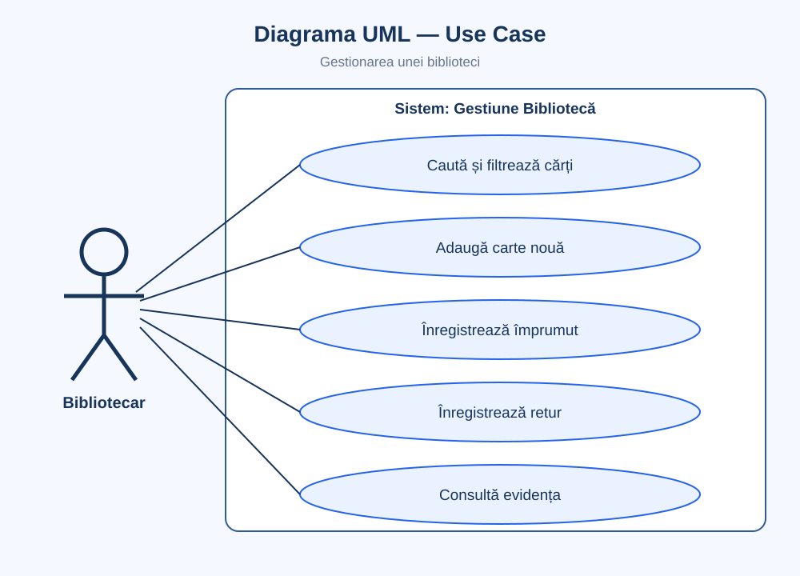

# Gestiune-Biblioteca-Desktop

**Autor:** Gurghiș Cosmin  
**Tema:** Proiectarea interfeței grafice și elaborarea documentației tehnice pentru aplicația desktop „Gestionarea unei biblioteci”.  
**Instrumente:** Figma, Git, GitHub, UML

## Despre proiect

Proiectul propune o aplicație desktop pentru evidența cărților, căutarea și filtrarea catalogului, adăugarea de cărți și înregistrarea împrumuturilor/retururilor. Este un **prototip de interfață**, nu o aplicație cu bază de date funcțională.

## Prototip Figma

**[Deschide proiectul Figma](https://www.figma.com/design/bf3t3D6BcYrOCW3tJPsD7A)**

Ecranele proiectate:
1. Catalogul principal al cărților — căutare, filtrare, disponibilitate.
2. Fereastra modală pentru înregistrarea unei cărți noi.
3. Fereastra pentru înregistrarea împrumutului/returului.

> Exporturile PNG/PDF ale interfețelor trebuie încă adăugate în folderul `prototype/`.

## Structura repository-ului

```text
Gestiune-Biblioteca-Desktop/
├── README.md
├── docs/
│   ├── descriere-proiect.md
│   ├── arhitectura-modulara.md
│   └── flux-git.md
├── diagrams/
│   ├── use-case.svg
│   └── arhitectura.svg
└── prototype/
    └── README.md
```

## Arhitectura modulară

Aplicația este organizată conceptual în trei straturi:
- **Interfața grafică (UI):** catalog, formulare, navigare.
- **Logica aplicației:** validarea datelor, verificarea disponibilității, regulile împrumutului și returului.
- **Stratul de date:** evidența cărților, cititorilor și împrumuturilor.



Mai multe detalii în [documentația arhitecturii](docs/arhitectura-modulara.md).

## Diagrama UML (Use Case)

Actor: **Bibliotecar**. Cazuri de utilizare: căutare/filtrare, adăugare carte, înregistrare împrumut, înregistrare retur și consultare evidență.



## Controlul versiunilor cu Git

Ramura `main` conține versiunea inițială. Pe ramura `feature/prototip-uml` sunt adăugate diagramele și documentația, care se integrează în `main` printr-un Pull Request.

Pașii Git sunt descriși în [docs/flux-git.md](docs/flux-git.md).

## Rezultat

Repository-ul conține designul conceptual, schemele tehnice, documentația și linkul către Figma. Interfețele sunt demonstrative; persistența datelor nu este implementată.
