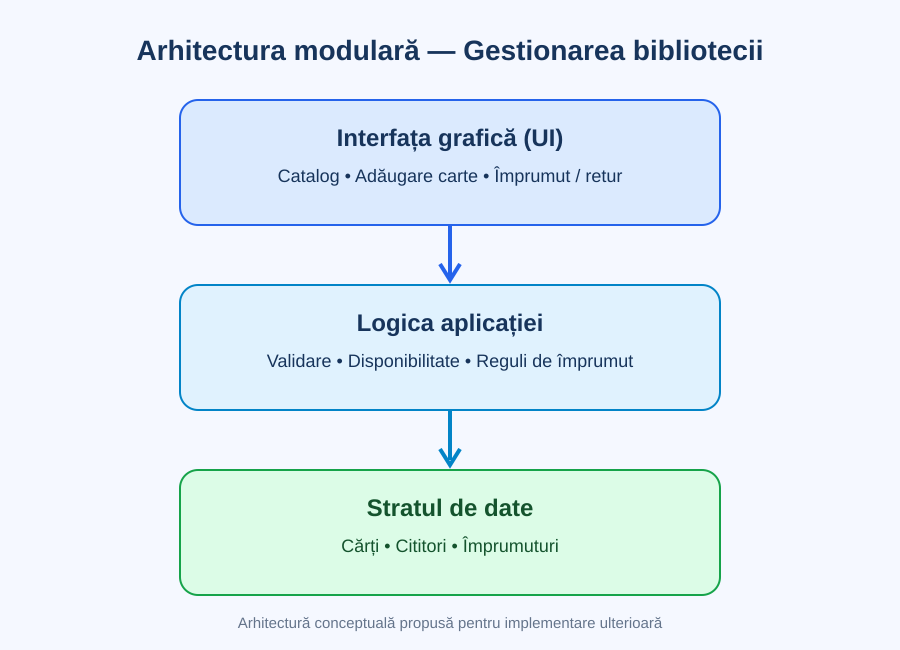

# Arhitectura modulară

Soluția propusă este organizată în trei straturi:

## 1. Interfața grafică (UI)
- Catalog de cărți cu căutare și filtrare.
- Modal pentru adăugarea unei cărți.
- Formular pentru împrumut și retur.

## 2. Logica aplicației
- Verificarea câmpurilor obligatorii.
- Verificarea disponibilității unei cărți.
- Aplicarea regulilor pentru împrumut și retur.
- Verificarea termenelor de returnare.

## 3. Stratul de date
- **Carte:** id, titlu, autor, ISBN, categorie, an, exemplare.
- **Cititor:** id, nume și informații de contact.
- **Împrumut:** id, carte, cititor, dată, termen, stare.

## Separarea responsabilităților
Interfața apelează logica aplicației; logica validează operațiile și comunică cu stratul de date. Interfața nu accesează direct baza de date.

**Notă:** Este o arhitectură conceptuală pentru implementarea ulterioară.
